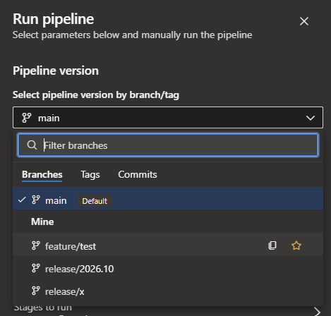
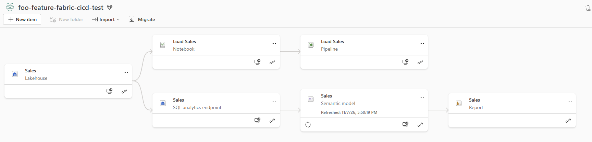
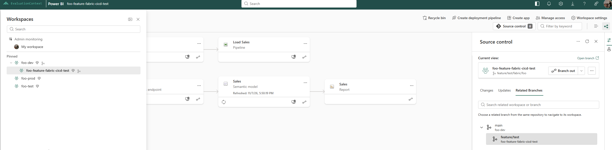
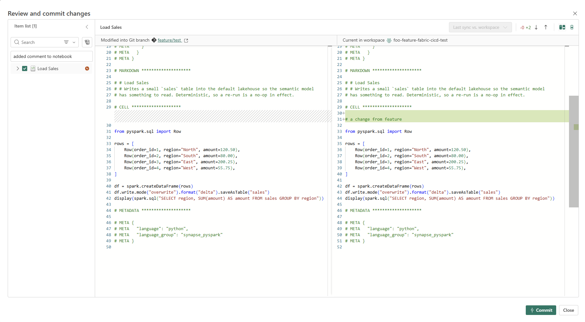
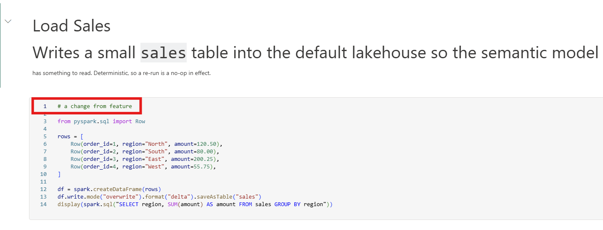

In the last post in the series ([Groundwork](https://evaluationcontext.com/posts/fabric-cicd-first-deploy/)) we deployed five items from a repo through dev, test and prod, without touching a workspace by hand. Nobody could develop on top of that yet. In this post each feature branch gets its own transient workspace. A pipeline creates it empty, a deploy fills it, git integration connects it to the branch, and it is deleted when the branch merges.

!!! info "fabric-cicd v1.3.0"

    This series is pinned to [fabric-cicd `1.3.0`](https://microsoft.github.io/fabric-cicd/1.3.0/) and [Fabric CLI `v1.7.0`](https://microsoft.github.io/fabric-cli/).

!!! example "Sample Repo"

    The code for this post is the :material-tag: [`post-2`](https://github.com/EvaluationContext/fabric-cicd-example/releases/tag/post-2) tag of :material-git: [EvaluationContext/fabric-cicd-example](https://github.com/EvaluationContext/fabric-cicd-example), building on [`post-1`](https://github.com/EvaluationContext/fabric-cicd-example/tree/post-1).

??? info "Starting Point"

    A quick recap of where we got to in the last [post](https://evaluationcontext.com/posts/fabric-cicd-first-deploy/).

    **The bar** the solution has to meet:

    - :material-package-variant-closed: **Cold start**: deploy into empty workspaces from the repo alone
    - :material-cursor-default-click-outline: **No clicks**: nothing manual beyond the initial setup
    - :material-repeat: **Idempotent**: the same result however many times it runs

    **The repo**, in Azure DevOps, holds one solution, `foo`, deployed with fabric-cicd through the Fabric CLI (`fab deploy`):

    ```text
    ├── 📁 .azure-pipelines
    │    ├── 📄 variables.yml                 # service connection names
    │    ├── 📄 deploy-main.yml               # main → foo-dev, on every merge
    │    ├── 📄 deploy-release.yml            # release/* → foo-test → approval → foo-prod
    │    └── 📁 templates
    │         ├── 📄 fab-setup-steps.yml      # install fab, log in as the SPN
    │         └── 📄 fab-deploy-steps.yml     # fab deploy one environment, publish the log
    └── 📁 fabric
          └── 📁 foo
              ├── 📁 Sales.Lakehouse
              ├── 📁 Load Sales.DataPipeline   # runs the notebook
              ├── 📁 Load Sales.Notebook       # writes the sales table to the lakehouse
              ├── 📁 Sales.SemanticModel       # Direct Lake on the lakehouse's SQL endpoint
              ├── 📁 Sales.Report              # bound to the model by path
              ├── 📄 config.yml                # env → workspace name, item types, publish rules
              └── 📄 parameter.yml             # two rules for the model's SQL endpoint
    ```

    **Branches** follow Microsoft's [Release Flow](https://learn.microsoft.com/en-us/devops/develop/how-microsoft-develops-devops):

    | :material-source-branch: Branch | :material-target: Purpose | :azure-pipelines: Pipeline | :fabric-workspace-outline: Workspace |
    | ------ | ------- | -------- | --------- |
    | `main` | The trunk. Feature pull requests land here, and it is always deployable | `deploy-main.yml`, triggered by every merge | `foo-dev` |
    | `feature/*` | Where work happens. Short-lived, merged to `main` by pull request | None yet | Transient, created for the feature branch, and destroyed after the branch is merged or deleted |
    | `release/*` | A release candidate, cut from `main`. Never merges back | `deploy-release.yml`, triggered by every push. Deploy to Test, a manual approval, then deploy to Prod | `foo-test` and `foo-prod` |

    ```mermaid
    flowchart LR
        subgraph Branches
            F[feature/*]
            M[main]
            R[release/*]
        end
        subgraph Pipelines
            DM[deploy-main.yml]
            DR[deploy-release.yml]
        end
        subgraph Workspaces
            D[foo-dev]
            T[foo-test]
            P[foo-prod]
        end
        F -- "pull request" --> M
        M -- "cut release" --> R
        M -- "merge" --> DM
        DM -- "fab deploy" --> D
        R -- "push" --> DR
        DR -- "fab deploy" --> T
        DR -- "fab deploy, after approval" --> P
    ```

    **Azure DevOps** holds:

    | Stage | :azure-pipelines: Pipeline | :material-source-branch: Branch | :material-connection: Service connection | :material-shield-check-outline: Environment | Checks |
    | ----- | -------- | ------ | ------------------ | ----------- | ------ |
    | Dev | `deploy-main.yml` | `main`, on every merge | `sc-fabric-deploy-nonprod` | `fabric-dev` | None |
    | Test | `deploy-release.yml` | `release/*`, on every push | `sc-fabric-deploy-nonprod` | `fabric-test` | None |
    | Prod | `deploy-release.yml` | `release/*`, after the Test stage | `sc-fabric-deploy-prod` | `fabric-prod` | Manual approval by :material-account-group-outline: `sg-fabric-approve-prod` |

    Both service connections use workload identity federation, so no secret is stored.

    **Entra** holds:

    | :material-robot-outline: Service principal | :material-account-group-outline: Security group | :material-shield-lock-outline: Tenant settings |
    | ----------------- | ----- | --------------- |
    | `sp-fabric-deploy-nonprod` <br> (:material-connection: `sc-fabric-deploy-nonprod`) | `sg-fabric-deploy-nonprod` | :material-checkbox-marked-outline: [Service principals can call Fabric public APIs](https://learn.microsoft.com/en-us/fabric/admin/service-admin-portal-developer#service-principals-can-call-fabric-public-apis)<br>:material-checkbox-marked-outline: [Service principals can create workspaces, connections, and deployment pipelines](https://learn.microsoft.com/en-us/fabric/admin/service-admin-portal-developer#service-principals-can-create-workspaces-connections-and-deployment-pipelines)<br>:material-checkbox-marked-outline: [Users can synchronize workspace items with their Git repositories](https://learn.microsoft.com/en-us/fabric/admin/git-integration-admin-settings) |
    | `sp-fabric-deploy-prod` <br> (:material-connection: `sc-fabric-deploy-prod`) | `sg-fabric-deploy-prod` | :material-checkbox-marked-outline: [Service principals can call Fabric public APIs](https://learn.microsoft.com/en-us/fabric/admin/service-admin-portal-developer#service-principals-can-call-fabric-public-apis) |

    One more group, :material-account-group-outline: `sg-fabric-approve-prod`, holds the people who approve a prod deploy.

    **Fabric** holds three workspaces on a capacity, named `<solution>-<env>`:

    | :fabric-workspace-outline: Workspace | Environment | :material-robot-outline: Workspace permissions | :material-git: Git integration |
    | --------- | ----------- | --------------------- | --------------- |
    | `foo-dev` | `dev` | `sp-fabric-deploy-nonprod`: Contributor | Not connected. Published by `deploy-main.yml` only |
    | `foo-test` | `test` | `sp-fabric-deploy-nonprod`: Contributor | Not connected. Published by `deploy-release.yml` only |
    | `foo-prod` | `prod` | `sp-fabric-deploy-prod`: Contributor | Not connected. Published by `deploy-release.yml` only |

    Each workspace holds the same five items, deployed from the repo:

    | Item | Reference | Bound by |
    | ---- | --------- | -------- |
    | :fabric-lakehouse-outline: `Sales` Lakehouse | | |
    | :fabric-notebook-outline: `Load Sales` Notebook | Writes the `sales` table to the lakehouse | Auto-binding, by logical id |
    | :fabric-pipeline-outline: `Load Sales` Data Pipeline | Runs the notebook | Auto-binding, by logical id |
    | :fabric-semantic-model-outline: `Sales` Semantic Model | Direct Lake on the lakehouse's SQL endpoint | The two `parameter.yml` rules |
    | :fabric-report-outline: `Sales` Report | Reads the semantic model | By path, resolved by folder name in the target workspace |

## Feature Workspaces

A feature branch holds one scoped piece of work, and a feature workspace is the isolated environment to build and test it in, so a developer can work without affecting anyone else. Three choices sit behind this design:

- :fabric-workspace-outline: **A workspace per branch.** Each :material-source-branch: `feature/*` branch has its own transient workspace, kept in sync with it in content through git integration and in existence: the workspace is created with the branch and torn down when the branch is merged. Work in progress stays in its workspace, and an urgent fix gets its own, so nobody has to commit half-finished work just to switch.
- :material-source-branch: **Branched out by a deploy.** Fabric's branch out is a git sync, and a sync only rebinds what the [binding matrix](https://learn.microsoft.com/en-us/fabric/cicd/cross-workspace-dependency-binding) says auto-binds: logical ids. References stored as other ids or literals are not covered, such as the semantic model's SQL endpoint in our example repo. So the workspace is filled by a deploy instead, which lets `parameter.yml` resolve the references auto-binding doesn't. I call this a [binding deploy](#binding-deploy).
- :azure-pipelines: **Provisioned by a pipeline.** No clicks and no hand-built workspaces. :azure-pipelines: `provision-feature.yml` builds the workspace when someone queues it, and a Teardown stage in :azure-pipelines: `deploy-main.yml` deletes it after the merge.

Feature workspaces follow a naming convention: :fabric-workspace-outline: `foo-feature-<repo slug>-<branch slug>`. The name is derived from the repo and the branch, and is therefore deterministic. That makes provisioning idempotent, because a re-run finds the workspace that already exists instead of creating a second one. It also scopes the teardown: the repo slug limits it to this repo's workspaces, and the branch tells it which of those can go.

### Provisioning Order

The order matters, because each step depends on the one before it:

1. :fabric-workspace-outline: **Create the workspace.** An empty workspace on the feature capacity, with roles granted.
2. :material-rocket-launch-outline: **Deploy into it.** A [binding deploy](#binding-deploy) fills the workspace, and `parameter.yml` resolves the references auto-binding doesn't cover to this workspace's items.
3. :material-source-branch: **Connect git and commit back.** Connecting before the deploy would sync the branch's unresolved references into the workspace. Connecting after it lets the workspace win, and the commit writes the resolved references to the branch.
4. :fabric-workspace-outline: **Relate it to dev (optional).** The workspace relation API needs both workspaces connected to the same repo, so it comes last. It is cosmetic: it nests the feature workspace under the dev workspace in the Fabric UI. The API is in preview, so the pipeline only warns if it refuses.

### Feature Deployment

#### Binding Deploy

Only a deploy runs `parameter.yml`, which is why a feature workspace is filled by one and not by a git sync. Its rules let fabric-cicd resolve, during the deployment, the references auto-binding doesn't cover: those stored as other ids or literals, which don't exist until the deployment starts.

Prefer a regex with a capture group, anchored on the structure around the value, over a `find_value` of one environment's literal. For example, `Sql\.Database\("([^"]+)",` matches whatever host follows `Sql.Database("` and replaces only the captured host, where a plain `find_value` of a literal will become stale during the [commit back](#commit-back) (below). The commit back writes the feature workspace's ids into the branch, and the merge carries them to `main`, so the literal in the file changes. A rule matching dev's value would stop matching, and fabric-cicd would still deploy green without replacing it.

A rule's `replace_value` takes one of two forms:

- **`_ALL_`**: one value for every environment, `feature` included. It has to be the only key. A [dynamic variable](https://microsoft.github.io/fabric-cicd/1.3.0/how_to/parameterization/#dynamic-replacement) such as `$items.<type>.<name>.$id` or `$workspace.$id`, which fabric-cicd resolves against the workspace being deployed to, means one value is enough

    ```yaml title="fabric/foo/parameter.yml"
    find_replace:
      - find_value: 'Sql\.Database\("([^"]+)",'
        is_regex: "true"
        replace_value:
          _ALL_: "$items.Lakehouse.Sales.$sqlendpoint"
        item_type: "SemanticModel"
        item_name: "Sales"
        file_path: "/Sales.SemanticModel/definition/expressions.tmdl"
    ```

- **Per-environment keys**: `dev`, `test` and `prod` each get their own value. There is none for `feature`, so fabric-cicd skips the rule in a feature workspace. Add a `feature` key with the value the feature workspace should get

    ```yaml
        replace_value:
          feature: "<feature value>"
          dev: "<dev value>"
          test: "<test value>"
          prod: "<prod value>"
    ```

#### Commit Back

Then we connect the workspace to the branch with git integration. Both sides now have content that differs, because `parameter.yml` overrode values on the feature workspace. We tell Fabric to resolve the conflict by committing from the workspace to the branch.

```diff title="fabric/foo/Sales.SemanticModel/definition/expressions.tmdl"
 expression DatabaseQuery =
 		let
-		    database = Sql.Database("fazr2kwaq6cu7eggbo3jwhcjpa-7oaosicotrlujkdbexkllwo7ce.datawarehouse.fabric.microsoft.com", "4f4ccee2-90a5-4efe-9c1a-d5f80ad37fc8")
+		    database = Sql.Database("[feature's endpoint host]", "[feature's endpoint id]")
 		in
 		    database
```

#### Feature Environment

The feature workspace name is derived from the repo and branch names (`foo-feature-<repo slug>-<branch slug>`), so `config.yml` can't hold a literal workspace name. It is resolved at run time and passed to fabric-cicd by the pipeline. We can still set publish and unpublish behavior. Unpublish is off for `feature`. We shouldn't need to deploy again after provisioning, but an accidental re-run should never delete something a developer has created and not committed.

```yaml title="fabric/foo/config.yml" hl_lines="3 10"
publish:
  skip:
    feature: false # the binding deploy, once, from provision-feature.yml
    dev: false
    test: false
    prod: false

unpublish:
  skip:
    feature: true  # never delete what a developer hasn't committed yet
    dev: false
    test: false
    prod: false
```

### Variable Libraries

I'm not using [variable libraries](https://learn.microsoft.com/en-us/fabric/cicd/variable-library/variable-library-overview) for item references. A [semantic model can't consume one](https://learn.microsoft.com/en-us/fabric/cicd/variable-library/variable-library-overview#supported-items), which rules out the binding we need most. For the types that can, the value is an item id that doesn't exist until the deploy creates it, so a `parameter.yml` rule would have to write it into the library. That is an extra item doing what `parameter.yml` already does, and it hides the rule behind a library lookup.

!!! tip "Non-item values"

    A library is fine for values that aren't item references. fabric-cicd activates the value set whose name matches the environment it is deploying to, so a `feature` value set would be activated in a feature workspace without any extra work.

## Setup

Four things need setting up once before the first feature workspace can be provisioned: :material-connection: the git connection, :material-server-outline: capacity access, :fabric-workspace-outline: the dev workspace and :material-account-group-outline: developer roles.

### Git Connection

To let developers commit from a feature workspace to git, we need an `Azure DevOps - Source control` connection, which lets the workspace authenticate with the Azure DevOps repo. The service principal `sp-fabric-deploy-nonprod` uses it, and the connect API needs the connection's id. Log in as :material-robot-outline: `sp-fabric-deploy-nonprod` so the SPN owns it, or make it as yourself and share it with the SPN under **Manage connections and gateways**:

```bash title="Create the git connection"
fab mkdir "/.connections/con-fabric-git-nonprod.Connection" -P \
  connectionDetails.type=AzureDevOpsSourceControl,\
  connectionDetails.creationMethod=AzureDevOpsSourceControl.Contents,\
  connectionDetails.parameters.url=https://dev.azure.com/<org>/<project>/_git/<repo>,\
  credentialDetails.type=ServicePrincipal,\
  credentialDetails.tenantId=<tenant id>,\
  credentialDetails.servicePrincipalClientId=<sp-fabric-deploy-nonprod client id>,\
  credentialDetails.servicePrincipalSecret=$GIT_SPN_SECRET
```

!!! warning "Client secret required"

    This is the first secret in the series. Workload identity federation covers the pipeline login, but a Fabric connection stores a credential, and for Azure DevOps the only kind a service principal can store is a client secret. Pass it from the shell, not a file: **Never store secrets in git**. To rotate it, update the credential on the existing connection ([Update Connection](https://learn.microsoft.com/en-us/rest/api/fabric/core/connections/update-connection)) rather than deleting and recreating it. A new connection gets a new id, and every feature workspace the SPN has connected holds the old id in its git credentials.

    ```bash title="Rotate the secret"
    connId=$(fab api connections | jq -r \
      '.text.value[] | select(.displayName=="con-fabric-git-nonprod") | .id')

    fab api -X patch "connections/$connId" -i "{
      \"connectivityType\": \"ShareableCloud\",
      \"credentialDetails\": {
        \"credentials\": {
          \"credentialType\": \"ServicePrincipal\",
          \"tenantId\": \"<tenant id>\",
          \"servicePrincipalClientId\": \"<sp-fabric-deploy-nonprod client id>\",
          \"servicePrincipalSecret\": \"$GIT_SPN_SECRET\"
        }
      }
    }"
    ```

Fabric runs its git operations as that credential, so the SPN also needs **Basic** access in the Azure DevOps organisation and **Contribute** on the repo. During provisioning it commits to the feature branch while setting up git integration, but only if the deploy and the `parameter.yml` rules rewrote files.

### Capacity

Creating a workspace on a capacity needs **Contributor permissions** on it. In the admin portal, **Capacity settings** :material-arrow-right: the capacity :material-arrow-right: **Contributor permissions**, add :material-account-group-outline: `sg-fabric-deploy-nonprod`. The capacity's display name goes in `variables.yml` as `featureCapacity`.

### Dev

Connect :fabric-workspace-outline: `foo-dev` to :material-source-branch: `main`, **Git folder** `fabric/foo`, from the workspace's **Source control** panel. This does one thing. The [workspace relation](https://learn.microsoft.com/en-us/rest/api/fabric/core/git/create-workspace-relation?tabs=HTTP) is what groups feature workspaces under their source workspace in the Fabric UI, and its API refuses workspaces that aren't connected to the same repo root. It is purely cosmetic. The pipeline is still the only thing that publishes dev.

!!! warning "Never sync dev"

    After the first merge, :material-source-branch: `main` holds a feature workspace's ids in `expressions.tmdl` and the notebook. Only a deploy rewrites them on the way in. Update dev from git and the model and notebook point at a workspace that has been torn down. So never sync.

### Roles

`sp-fabric-deploy-nonprod` will create the workspace, and therefore will have **Admin** permissions on it. For developers to work in the workspace, they need **Contributor** permissions. Add Developers to a security group :material-account-group-outline: `sg-fabric-developers`, so they can be granted **Contributor** on a feature workspace, as part of the provision process. That is enough to work in the workspace. Committing from it to the branch needs a little more.

```json title=".azure-pipelines/feature-workspace-roles.json"
[
  {
    "principal": "sg-fabric-developers",
    "id": "<object id>",
    "role": "contributor"
  }
]
```

Developers only ever commit from the workspace to the branch. They never update the workspace from git, so commit is the only git operation they need. On top of **Contributor**, that takes:

- :material-shield-lock-outline: **Tenant setting**: add :material-account-group-outline: `sg-fabric-developers` to [Users can synchronize workspace items with their Git repositories](https://learn.microsoft.com/en-us/fabric/admin/git-integration-admin-settings) in the tenant settings.
- :azure-pipelines: **Azure DevOps**: **Read** and **Contribute** on the repo, and any branch policy must allow direct commits to :material-source-branch: `feature/*`. Git credentials are per user, and for Azure DevOps Fabric sets up a developer's from their own sign-in, so their own account needs the access

!!! info "Switching branches"

    The workspace setting *Allow users with at least Contributor role to change Git branch* is not needed. Nobody switches a feature workspace to another branch.

## Provision Pipeline

:azure-pipelines: `provision-feature.yml` runs the steps from [Provisioning Order](#provisioning-order). Branch :material-source-branch: `feature/<branch-name>` in the repo `fabric-cicd` becomes :fabric-workspace-outline: `foo-feature-fabric-cicd-<branch-slug>`.

The pipeline has no trigger and is run manually against a specific branch: **Run pipeline**, pick the branch under **Branch/tag**, run. This is deliberate. Not every branch needs a workspace, a docs-only change doesn't, and a CI trigger would spin up an agent for no reason. A push trigger would also run the binding deploy over the workspace on every push, publishing the branch over whatever is uncommitted in it. The dialog defaults to :material-source-branch: `main`, so the first step refuses anything that isn't :material-source-branch: `feature/*`.

```diff
 ├── 📁 .azure-pipelines
+│    ├── 📄 provision-feature.yml           # run by hand on a feature branch, builds its workspace
+│    ├── 📄 feature-workspace-roles.json    # who gets which role on a feature workspace
 │    ├── 📄 variables.yml                   # gains the feature capacity and git connection names
 │    ├── 📄 deploy-main.yml                 # gains a Teardown stage that deletes merged branches' workspaces
 │    ├── 📄 deploy-release.yml
 │    └── 📁 templates
 │         ├── 📄 fab-setup-steps.yml
 │         └── 📄 fab-deploy-steps.yml       # gains an optional config override, for the feature workspace name
```

The steps from [Provisioning Order](#provisioning-order), one script each:

=== "provision-feature.yml"

    ```yaml
    trigger: none
    pr: none

    variables:
      - template: variables.yml

    jobs:
      - job: ProvisionFeature
        displayName: Provision feature workspace
        pool:
          vmImage: ubuntu-latest
        steps:
          # The Run dialog defaults to main. Refuse anything but feature/*, and
          # derive the workspace name: feature/average-amount in repo fabric-cicd
          # → foo-feature-fabric-cicd-average-amount
          - script: |
              set -euo pipefail
              case "$BUILD_SOURCEBRANCH" in
                refs/heads/feature/*) ;;
                *)
                  echo "##vso[task.logissue type=error]provision-feature runs on feature/* only. Run pipeline, pick the branch under Branch/tag."
                  exit 1 ;;
              esac
              branch="${BUILD_SOURCEBRANCH#refs/heads/}"
              slug() { printf '%s' "$1" | tr 'A-Z' 'a-z' | tr -cs 'a-z0-9' '-' | sed 's/^-//; s/-$//'; }
              repoSlug=$(slug "$BUILD_REPOSITORY_NAME")
              branchSlug=$(slug "${branch#feature/}")
              echo "##vso[task.setvariable variable=branch]$branch"
              echo "##vso[task.setvariable variable=workspace]foo-feature-$repoSlug-$branchSlug"
            displayName: Guard feature/* and name the workspace

          - checkout: self

          - template: templates/fab-setup-steps.yml
            parameters:
              serviceConnection: ${{ variables.serviceConnectionDev }}

          # 1. Create: an empty workspace on the capacity, roles from a file
          - script: |
              set -euo pipefail
              ws="$(workspace)"
              if wsId=$(fab get "/$ws.Workspace" -q id 2>/dev/null | tr -cd '0-9a-fA-F-'); then
                echo "exists:  $ws ($wsId)"
              else
                fab mkdir "/$ws.Workspace" -P capacityName="$(featureCapacity)"
                wsId=$(fab get "/$ws.Workspace" -q id | tr -cd '0-9a-fA-F-')
                echo "created: $ws ($wsId)"
              fi
              echo "##vso[task.setvariable variable=workspaceId]$wsId"

              # The humans. The SPN is already Admin: it created the workspace.
              jq -c '.[]' .azure-pipelines/feature-workspace-roles.json |
              while read -r assignment; do
                fab acl set "/$ws.Workspace" \
                  -I "$(jq -r '.id' <<<"$assignment")" \
                  -R "$(jq -r '.role' <<<"$assignment")" -f
              done
            displayName: Create workspace and grant roles

          # 2. Fill: the binding deploy. config.yml names no feature workspace;
          #    the derived name rides in as a config override for this run only.
          - template: templates/fab-deploy-steps.yml
            parameters:
              targetEnv: feature
              configOverride: '{"core":{"workspace":{"feature":"$(workspace)"}}}'

          # 3. Connect: git integration to the branch, workspace side wins, commit
          - script: |
              set -euo pipefail
              ws="$(workspace)"; wsId="$(workspaceId)"; branch="$(branch)"
              org="$(basename "${SYSTEM_COLLECTIONURI%/}")"

              # The SPN's git credential lives in a Fabric connection, by name.
              connId=$(fab api connections | jq -r \
                ".text.value[] | select(.displayName==\"$(gitConnection)\") | .id")
              [ -n "$connId" ] || { echo "##vso[task.logissue type=error]git connection '$(gitConnection)' not found or not shared with the SPN"; exit 1; }

              # A re-run finds the workspace already connected, so connect only when it is not.
              state=$(fab api "workspaces/$wsId/git/connection" | jq -r '.text.gitConnectionState')
              if [ "$state" = "NotConnected" ]; then
                fab api -X post "workspaces/$wsId/git/connect" -i "{
                  \"gitProviderDetails\": {
                    \"gitProviderType\": \"AzureDevOps\",
                    \"organizationName\": \"$org\",
                    \"projectName\": \"$SYSTEM_TEAMPROJECT\",
                    \"repositoryName\": \"$BUILD_REPOSITORY_NAME\",
                    \"branchName\": \"$branch\",
                    \"directoryName\": \"fabric/foo\"
                  },
                  \"myGitCredentials\": { \"source\": \"ConfiguredConnection\", \"connectionId\": \"$connId\" }
                }"
                echo "connected: $ws → $branch (fabric/foo)"
              fi
              state=$(fab api "workspaces/$wsId/git/connection" | jq -r '.text.gitConnectionState')
              [ "$state" != "NotConnected" ] || { echo "##vso[task.logissue type=error]could not connect $ws to $branch"; exit 1; }
              [ "$state" != "ConnectedAndInitialized" ] || { echo "initialized: $ws is already in sync, nothing to commit"; exit 0; }

              # Both sides have content. The deploy just published the branch into
              # the workspace, so the workspace wins and Fabric asks for a commit.
              action=$(fab api -X post "workspaces/$wsId/git/initializeConnection" \
                -i '{"initializationStrategy": "PreferWorkspace"}' | jq -r '.text.requiredAction')
              case "$action" in
                CommitToGit) ;;
                None) echo "initialized: nothing to commit"; exit 0 ;;
                *)
                  echo "##vso[task.logissue type=error]initialize asked for '$action': the branch holds something the deploy did not publish. Every item folder under fabric/foo must be in item_types_in_scope."
                  exit 1 ;;
              esac

              # The commit: the workspace's ids over the branch's. workspaceHead
              # comes from the status API, and is absent before the first sync.
              body=$(fab api "workspaces/$wsId/git/status" | jq -c \
                '{mode: "All", comment: "Binding deploy: '"$ws"' [skip ci]"}
                 + (if .text.workspaceHead then {workspaceHead: .text.workspaceHead} else {} end)')
              fab api -X post "workspaces/$wsId/git/commitToGit" -i "$body"

              # Read-back: the commit is async, poll until the workspace head is the
              # branch head.
              for i in $(seq 1 30); do
                status=$(fab api "workspaces/$wsId/git/status")
                head=$(jq -r '.text.workspaceHead' <<<"$status")
                remote=$(jq -r '.text.remoteCommitHash' <<<"$status")
                if [ "$head" != "null" ] && [ "$head" = "$remote" ]; then
                  echo "committed: $branch at $head"; exit 0
                fi
                sleep 10
              done
              echo "##vso[task.logissue type=error]commit never landed on $branch"
              exit 1
            displayName: Connect to git and commit

          # 4. Relate: to dev, for the Fabric UI only. Preview API, warn on refusal.
          - script: |
              set -euo pipefail
              wsId="$(workspaceId)"
              dev=$(python -c "import yaml; print(yaml.safe_load(open('fabric/foo/config.yml'))['core']['workspace']['dev'])")
              # Keep only the GUID: fab output can carry a stray control character, which
              # is invalid inside the JSON body below.
              devId=$(fab get "/$dev.Workspace" -q id | tr -cd '0-9a-fA-F-')
              if fab api -X post "workspaces/$wsId/git/workspaceRelations" \
                   -i "{\"relatedWorkspaceId\": \"$devId\", \"relationType\": \"Base\"}"; then
                echo "related: $(workspace) → $dev"
              else
                echo "##vso[task.logissue type=warning]could not relate $(workspace) to $dev; the workspace works without it, the UI just won't list it under dev"
              fi
            displayName: Relate to dev
    ```

=== "fab-deploy-steps.yml"

    ```diff
     parameters:
       - name: targetEnv
    -    displayName: Target environment key in config.yml (dev / test / prod)
    +    displayName: Target environment key in config.yml (feature / dev / test / prod)
         type: string

       - name: configFile
         displayName: Path to the fabric-cicd config.yml
         type: string
         default: fabric/foo/config.yml

    +  - name: configOverride
    +    displayName: JSON merged over config.yml for this run (empty for none)
    +    type: string
    +    default: ''
    +
     steps:
       - script: |
           set -euo pipefail
           config="${{ parameters.configFile }}"
           env="${{ parameters.targetEnv }}"
    +      override='${{ parameters.configOverride }}'
    +      args=()
    +      [ -n "$override" ] && args=(-P "config_override=$override")
           ...
    -      fab deploy --config "$config" --target_env "$env" --force 2>&1 | tee -a "$log"
    +      fab deploy --config "$config" --target_env "$env" --force "${args[@]}" 2>&1 | tee -a "$log"
    ```

=== "variables.yml"

    ```yaml
    variables:
      serviceConnectionDev: sc-fabric-deploy-nonprod
      serviceConnectionProd: sc-fabric-deploy-prod

      # provision-feature.yml. The capacity feature workspaces are created on, by
      # display name. The non-prod SPN needs Contributor permissions on it.
      featureCapacity: evaluationcontext

      # provision-feature.yml. The Fabric connection holding the non-prod SPN's
      # Azure DevOps credential, by display name.
      gitConnection: con-fabric-git-nonprod
    ```

!!! warning "Pull before you push"

    The pipeline's commit is a commit on your branch, so `git pull` before you push again.

With that set up we can create a branch `feature/test`. It has to be pushed to Azure DevOps first, because the pipeline can only run a branch that exists on the remote, and git integration connects the workspace to that remote branch.

```bash
git switch -c feature/test
git push -u origin feature/test
```

Then run the pipeline on it to provision a feature workspace.



After the pipeline has finished we can check the lineage view of :fabric-workspace-outline: `foo-feature-fabric-cicd-test`. It shows the semantic model reading its own lakehouse (rather than Dev's), so the binding deploy worked.



We can also see the relationship from the dev workspace's perspective, where the feature workspace is listed as a branch.



## Developing

### In the Workspace

We can work in the workspace as normal. I opened the `Load Sales` notebook, added a comment to its cell.

```diff title="fabric/foo/Load Sales.Notebook/notebook-content.py"
 # CELL ********************

+# a change from feature
+
 from pyspark.sql import Row
```

The **Source control** panel shows the same change as an uncommitted diff, which I committed to the feature branch.



### From the Repo

A definition edited in VS Code, or by an agent, needs to get from the repo into the workspace. Git integration can do that, by updating the workspace from the branch, but I don't use it, for three reasons:

- **Throwaway commits**: git integration only sees committed state, so testing an edit means committing it first, and committing again for every fix
- **Poor errors**: an update from git applies the whole branch and reports one coarse status for the workspace, rather than which item failed and why
- **Agentic loops**: an agent needs a fast loop of apply, read the error, fix, apply again, and a commit per iteration is neither fast nor clean. This is the discover, apply, verify pattern in Microsoft's [skills-for-fabric](https://github.com/microsoft/skills-for-fabric)

Instead `fab import` pushes one item, and a read-back proves it landed.

```bash
ws="foo-feature-fabric-cicd-test"

# apply: one item, one call
fab import -f "/$ws.Workspace/Load Sales.Notebook" -i "fabric/foo/Load Sales.Notebook" --format .py &&
  echo "PASS import Load Sales.Notebook" ||
  { echo "FAIL import Load Sales.Notebook"; exit 1; }

# verify: read it back from the workspace, not the repo
fab get "/$ws.Workspace/Load Sales.Notebook" -q "id" >/dev/null &&
  echo "PASS read-back Load Sales.Notebook" ||
  { echo "FAIL read-back Load Sales.Notebook"; exit 1; }

# a run proves it works
fab job run "/$ws.Workspace/Load Sales.Notebook"
```

!!! warning "Not a promotion mechanism"

    No `parameter.yml` is involved. The item lands exactly as authored, so an item from a branch that hasn't had its ids committed back lands with unresolved ones. This loop is for feature development only, never promotion.

## Pull Request

Before submitting a Pull Request, review `parameter.yml` to add rules for any new item that needs a rule or an existing rule that needs changing.

The pull request in our case shows two commits: first the binding deploy's commit, and then the notebook comment.

Merge, with **Delete source branch** ticked, because Teardown only removes a workspace once its branch is gone. :azure-pipelines: `deploy-main` runs its Dev stage as before. Then a new Teardown stage deletes this repo's feature workspaces whose branch is gone from the remote. If in doubt, a workspace is kept. It is deleted only if every one of these checks passes:

- :material-source-branch: **Same repo**: its git connection names this repo. Two repos with overlapping slugs can share a name prefix, but not a repository name
- :material-source-branch: **A feature branch**: it is connected to a `feature/*` branch, so nothing connected to `main` is ever a candidate
- :fabric-workspace-outline: **Provisioned for that branch**: its name is exactly the one the provision pipeline derives from the repo and branch
- :azure-pipelines: **Branch confirmed gone**: `git ls-remote` exits 2, meaning the remote answered and the branch is not there. Any other exit code is a failure to ask, so the workspace is kept with a warning

```yaml title="deploy-main.yml (Teardown stage)"
  - stage: Teardown
    displayName: Teardown feature workspaces
    dependsOn: Dev
    # Only a run on main may delete anything.
    condition: and(succeeded(), eq(variables['Build.SourceBranch'], 'refs/heads/main'))
    jobs:
      - job: TeardownFeatureWorkspaces
        displayName: Delete workspaces for merged branches
        pool:
          vmImage: ubuntu-latest
        steps:
          - checkout: self
            persistCredentials: true   # git ls-remote against the repo

          - template: templates/fab-setup-steps.yml
            parameters:
              serviceConnection: ${{ variables.serviceConnectionDev }}

          - script: |
              set -euo pipefail
              slug() { printf '%s' "$1" | tr 'A-Z' 'a-z' | tr -cs 'a-z0-9' '-' | sed 's/^-//; s/-$//'; }
              # If in doubt, keep. A workspace is deleted only when every check below
              # passes; a failed check, an odd name or a failed git call keeps it.
              repo="$BUILD_REPOSITORY_NAME"
              prefix="foo-feature-$(slug "$repo")-"

              # Delete nothing unless the remote answers and still has main, so an
              # unreachable remote can never read as "every branch is gone".
              git ls-remote --exit-code --heads origin refs/heads/main >/dev/null

              # Only workspaces the SPN holds a role on come back, which is
              # why provisioning kept it Admin. Delete is Admin-only too.
              fab api workspaces |
                jq -r --arg p "$prefix" '.text.value[]
                  | select(.displayName | startswith($p)) | [.id, .displayName] | @tsv' |
              while IFS=$'\t' read -r wsId wsName; do
                conn=$(fab api "workspaces/$wsId/git/connection" </dev/null)
                connRepo=$(jq -r '.text.gitProviderDetails.repositoryName // empty' <<<"$conn")
                branch=$(jq -r '.text.gitProviderDetails.branchName // empty' <<<"$conn")

                # Every check must pass, or the workspace is kept.
                if [ "$connRepo" != "$repo" ]; then
                  echo "keep:   $wsName (connected to '$connRepo', not $repo)"; continue
                fi
                case "$branch" in
                  feature/?*) ;;
                  *) echo "keep:   $wsName ('$branch' is not a feature branch)"; continue ;;
                esac
                if [ "$wsName" != "$prefix$(slug "${branch#feature/}")" ]; then
                  echo "keep:   $wsName (not the workspace provisioned for $branch)"; continue
                fi

                # ls-remote exits 0 when the branch exists and 2 when it does not. Any
                # other code means the check failed, which is not an answer.
                rc=0
                git ls-remote --exit-code --heads origin "refs/heads/$branch" </dev/null >/dev/null || rc=$?
                case "$rc" in
                  0) echo "keep:   $wsName ($branch still exists)" ;;
                  2) echo "delete: $wsName ($branch is gone)"
                     fab api -X delete "workspaces/$wsId" </dev/null ;;
                  *) echo "##vso[task.logissue type=warning]kept $wsName: could not check $branch (git exit $rc)" ;;
                esac
              done
            displayName: Teardown
```

## Release

We can then cut :material-source-branch: `release/2026.11` to kick off `deploy-release`, which deploys to :fabric-workspace-outline: `foo-test` and, after the manual approval, to :fabric-workspace-outline: `foo-prod`.

The comment from the feature branch is in the prod notebook.


