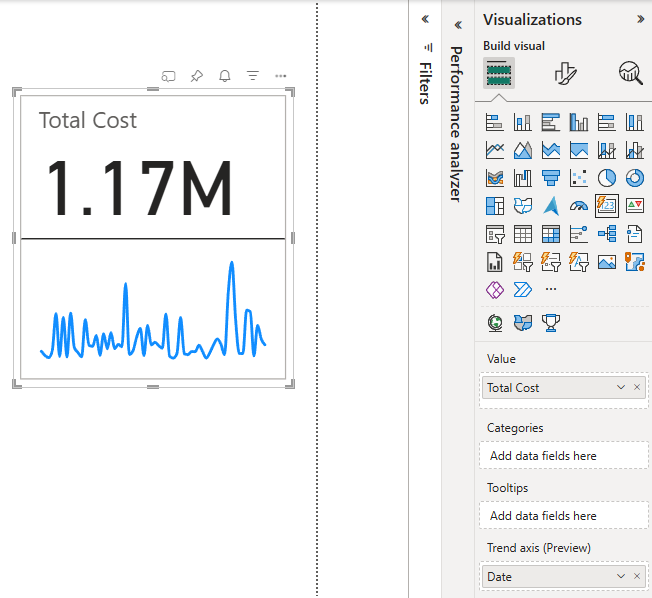
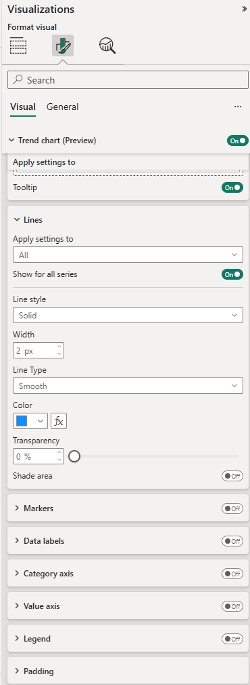
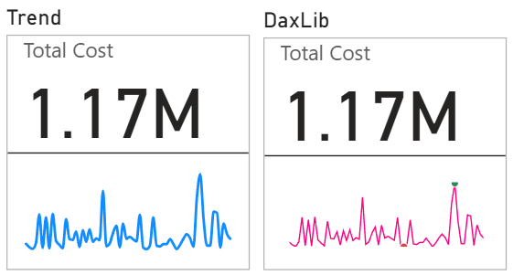
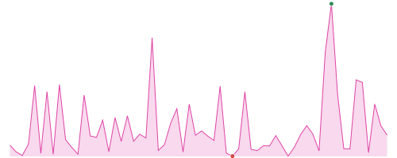
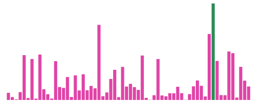
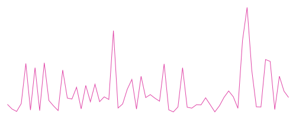
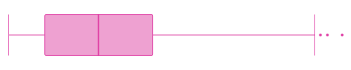

It feels like I've not written about Power BI in forever. Then the [Power BI November 2026 Feature Summary](https://community.fabric.microsoft.com/blog/fbc_pbiupdatesblog/power-bi-november-2026-feature-summary/5414287#community-5414287-mcetoc_1k78q1ev0_12) announced **Card visual trend charts (preview)**. They reminded me of [sparklines](https://learn.microsoft.com/en-us/power-bi/create-reports/power-bi-sparklines-tables), and the [interesting queries](https://www.sqlbi.com/tv/performance-of-sparklines-dax-in-power-bi-unplugged/) they generate, so I was curious about how these trend charts work.

Up until now if you wanted a chart inside a card you needed an SVG measure, which is the reason [DaxLib.SVG](https://daxlib.org/package/DaxLib.SVG/) exists. Now we have options, so I also wanted to compare performance to know which to reach for.

## Trend Charts

For testing I used the Power BI report that ships with DaxLib.SVG in the [:material-github: daxlib/dev-daxlib-svg](https://github.com/daxlib/dev-daxlib-svg) repo.

Adding a trend chart is super easy. You create a card, add a measure (`Total Cost`) to the **Value** well and a field (`Dates[Date]`) to the **Trend axis (Preview)** well.



Then we have the option to choose from **four** chart types:

- :material-chart-line: Line
- :material-chart-bar: Column
- :material-align-horizontal-left: Bar
- :material-map-outline: Shape map

You have a lot of flexibility in styling the charts: you can edit the line and bar styles, markers, data labels and axes.



You can do all of that with an SVG too, but because this is a native chart you also get tooltips on hover and can select points to cross-highlight/filter.

## Under the Hood

### Sparklines

Before looking at the card, it is worth remembering how the other native small chart gets its data. A sparkline adds some extra DAX to a visual's query. It collects the axis values and the measure value for each, samples them, and normalizes them. The points are collected as x,y pairs in `"p":[...]`, which is not too dissimilar to the `points` of an SVG `#!xml <polyline>`.

??? example "Sparkline Query (excerpt)"

    ```dax
    VAR __Result =
        ("{""p"":[" &
            CONCATENATEX(
                __Sync_Data,
                ("[" &
                FORMAT([ScalarKey], "General Number", "en-US") &
                IF(
                    ISBLANK([Value]),
                    "",
                    CONCATENATE(",", FORMAT(DIVIDE([Value] - __MinY_Value, __RangeY, 0) * 100, "0.0", "en-US"))
                ) &
                 "]"),
                ",",
                [ScalarKey],
                ASC
            ) &
        "],""yl"":" &
        FORMAT(__MinY_Value, "General Number", "en-US") &
        ",""yh"":" &
        FORMAT(__MaxY_Value, "General Number", "en-US") &
        ",""xl"":" &
         FORMAT(__MinX_Value, "General Number", "en-US") &
        ",""xh"":" &
        FORMAT(__MaxX_Value, "General Number", "en-US") &
        IF(
            ISBLANK(__Min_Interval),
            "",
            CONCATENATE(",""md"":", FORMAT(__Min_Interval, "General Number", "en-US"))
        ) &
        "}")
    ```

### Trend Chart Query

So the first question is, do trend charts work in a similar way? To find out I opened Performance Analyzer, refreshed the visual and copied the query.

```dax
DEFINE
	VAR __DS0Core = 
		SUMMARIZECOLUMNS(
			ROLLUPADDISSUBTOTAL('Dates'[Date], "IsGrandTotalRowTotal"),
			"Total_Cost", '_Measures'[Total Cost]
		)

	VAR __DS0KeyValues = 
		GROUPBY(
			__DS0Core,
			"MinTotal_Cost", MINX(CURRENTGROUP(), [Total_Cost]),
			"MaxTotal_Cost", MAXX(CURRENTGROUP(), [Total_Cost])
		)

	VAR __M0Min = 
		SELECTCOLUMNS(
			KEEPFILTERS(__DS0KeyValues),
			"MinTotal_Cost", [MinTotal_Cost]
		)

	VAR __M0Max = 
		SELECTCOLUMNS(
			KEEPFILTERS(__DS0KeyValues),
			"MaxTotal_Cost", [MaxTotal_Cost]
		)

	VAR __DS0KeyPoints = 
		FILTER(
			KEEPFILTERS(__DS0Core),
			AND(
				AND(OR([Total_Cost] = __M0Min, [Total_Cost] = __M0Max), NOT(__M0Min = __M0Max)),
				NOT([Total_Cost] = 0)
			)
		)

	VAR __DS0KeyPointsLimited = 
		TOPN(10, __DS0KeyPoints, [IsGrandTotalRowTotal], 1, 'Dates'[Date], 1)

	VAR __DS0KeyPointsLimitedCount = CALCULATE(COUNTROWS(__DS0KeyPointsLimited))

	VAR __DS0BodyLimited = 
		SAMPLE(102, __DS0Core, [IsGrandTotalRowTotal], 1, 'Dates'[Date], 1)

	VAR __DS0BodyWithKeyPoints = 
		DISTINCT(UNION(__DS0BodyLimited, __DS0KeyPointsLimited))

EVALUATE
	ROW(
	"DS0KeyPointsLimitedCount", __DS0KeyPointsLimitedCount
)

EVALUATE
	__DS0BodyWithKeyPoints

ORDER BY
	[IsGrandTotalRowTotal], 'Dates'[Date]
```

The answer is **no**. A sparkline normalizes the points and builds a string inside the query. The card just asks for rows, one per date with the raw measure value, and leaves the scaling and drawing to the visual.

`__DS0Core` gets a table of `#!dax 'Dates'[Date]` and `#!dax [Total Cost]`, with a grand total row, which is the callout value. So the callout and the trend come back from the same query.

The rest of the query is just data reduction on that table. It samples the data, but makes sure to keep the rows with the min and max measure value, for the axis scaling, and to report accurately on those extremes. Since it is sampling, if you plot against a high cardinality axis you might miss out key details.

### DaxLib.SVG

We can create an equivalent card with DaxLib.SVG, by adding a `#!dax DaxLib.SVG.Compound.Line()` measure to the card as an image.



This is the measure and the query it generates:

```dax
DEFINE 
MEASURE '_Measures'[Compound.Line] =
    VAR Compound = 
        DaxLib.SVG.Compound.Line(
            0,                  // x
            0,                  // y
            100,                // width
            20,                 // height
            Dates[Date],        // axisRef
            [Total Cost],       // measureRef
            "#FF0080",          // lineColor
            "#D04848",          // minMarkColor
            "#2E8B57",          // maxMarkColor
            false,              // showAxis
            8                   // axisFontSize
        )
    RETURN

        IF(
            NOT ISBLANK( Compound ),
            DaxLib.SVG.SVG(
                100,            // width
                20,             // height
                Compound
            )
        )

EVALUATE
ROW(
    "Compound_Line", '_Measures'[Compound.Line],
    "Total_Cost", '_Measures'[Total Cost]
)
```

Here the grouping over `Dates[Date]` happens inside the measure, and the query returns a single SVG string alongside the callout value.

## Performance

So we can create two similar looking cards, do they differ in performance?

I ran the DAX requested by the two visuals in DAX Studio three times each, clearing the cache between runs, and capturing the server timings. The one thing to note is DaxLib.SVG doesn't sample points, but there are only 62 dates with measure values, so it will not be a factor in this test.

| | Total (ms) | FE (ms) | SE (ms) | SE queries |
|---|---|---|---|---|
| Native Trend | 17 | 17 | 0 | 1 |
| DaxLib.SVG | 94 | 94 | 0 | 3 |

The query is only half of it. Performance Analyzer splits each visual into the DAX query and the visual display, and I found in [SVG Rendering Cost in Power BI](https://evaluationcontext.com/posts/SVG-Render-Cost/) that the render side is worth checking too.

| | Total (ms) | DAX Query (ms) | Visual display (ms) | Other (ms) |
|---|---|---|---|---|
| Native Trend | 194 | 62 | 19 | 113 |
| DaxLib.SVG | 494 | 124 | 20 | 350 |

The visual display is the same for both, so the difference is in the DAX query: **17 ms** vs **94 ms** in DAX Studio, and 62 ms vs 124 ms in Performance Analyzer. Other includes time spent waiting on other visuals, so I wouldn't read much into it. The numbers are quite small but I think they are different enough to say that the trend charts are more performant. This was a limited test on a small semantic model though, so take it with a pinch of salt.

## Showdown

The trend chart is the user friendly option. It is a field well and some Format pane options, nothing to install and no DAX to write, so anyone building a report can add one without leaving Power BI. It also has the tooltips on hover and the cross-highlighting that an SVG can't give you. You get axes and labels too, but that isn't a point of difference, since DaxLib.SVG has those as well.

The limits are the other side. Trend charts are only available in cards. In a table or matrix the native option is still sparklines, and that is where I use SVG measures the most.

You also only get four chart types, where DaxLib.SVG has nine ready made in `#!dax DaxLib.SVG.Viz.*`, and you can build your own from the elements. Scroll along to see them all:

<div class="ec-gallery" markdown>
<figure markdown>

<figcaption markdown>[Area](https://evaluationcontext.com/daxlib.svg/viz/Viz.Area/)</figcaption>
</figure>
<figure markdown>

<figcaption markdown>[Bars](https://evaluationcontext.com/daxlib.svg/viz/Viz.Bars/)</figcaption>
</figure>
<figure markdown>

<figcaption markdown>[Line](https://evaluationcontext.com/daxlib.svg/viz/Viz.Line/)</figcaption>
</figure>
<figure markdown>

<figcaption markdown>[Boxplot](https://evaluationcontext.com/daxlib.svg/viz/Viz.Boxplot/)</figcaption>
</figure>
<figure markdown>

<figcaption markdown>[Violin](https://evaluationcontext.com/daxlib.svg/viz/Viz.Violin/)</figcaption>
</figure>
<figure markdown>

<figcaption markdown>[Jitter](https://evaluationcontext.com/daxlib.svg/viz/Viz.Jitter/)</figcaption>
</figure>
<figure markdown>

<figcaption markdown>[Heatmap](https://evaluationcontext.com/daxlib.svg/viz/Viz.Heatmap/)</figcaption>
</figure>
<figure markdown>

<figcaption markdown>[ProgressBar](https://evaluationcontext.com/daxlib.svg/viz/Viz.ProgressBar/)</figcaption>
</figure>
<figure markdown>

<figcaption markdown>[Pill](https://evaluationcontext.com/daxlib.svg/viz/Viz.Pill/)</figcaption>
</figure>
</div>

| | Card Trend Chart | DaxLib.SVG |
|---|---|---|
| Setup | Trend axis field well and Format pane | Install the library, write a measure |
| Chart types | :material-chart-line: Line<br>:material-chart-bar: Column<br>:material-align-horizontal-left: Bar<br>:material-map-outline: Shape map<br><span style="opacity: 0.35">:material-chart-areaspline: Area<br>:material-chart-box-outline: Boxplot<br>:material-chart-bell-curve: Violin<br>:material-chart-scatter-plot: Jitter<br>:material-view-grid: Heatmap<br>:material-progress-check: Progress bar<br>:material-pill: Pill<br>:material-hammer-wrench: Build your own</span> | :material-chart-line: Line<br>:material-chart-bar: Column<br><span style="opacity: 0.35">:material-align-horizontal-left: Bar<br>:material-map-outline: Shape map</span><br>:material-chart-areaspline: Area<br>:material-chart-box-outline: Boxplot<br>:material-chart-bell-curve: Violin<br>:material-chart-scatter-plot: Jitter<br>:material-view-grid: Heatmap<br>:material-progress-check: Progress bar<br>:material-pill: Pill<br>:material-hammer-wrench: Build your own |
| Tooltips on hover | :material-check:{ style="color: #2E8B57" } | :material-close:{ style="color: #D04848" } |
| Cross-highlighting | :material-check:{ style="color: #2E8B57" } | :material-close:{ style="color: #D04848" } |
| Axes and labels | :material-check:{ style="color: #2E8B57" } | :material-check:{ style="color: #2E8B57" } |
| Cards | :material-check:{ style="color: #2E8B57" } | :material-check:{ style="color: #2E8B57" } |
| DAX query | 17 ms | 94 ms |
| Status | Preview | v2.0.0 |

## Conclusion

If you want a chart in a card, and one of the available chart types and the formatting options gets you the effect you want, use the trend chart. It is easy to set up, you get tooltips and cross-highlighting, and it performs better. If you want something more bespoke, reach for an SVG.

The same applies to sparklines in tables and matrices: use the native option if it does what you need and an SVG if it doesn't.
