Rayfin is now in Power BI Desktop. It was announced at [Ignite](https://community.fabric.microsoft.com/blog/fbc_pbiupdatesblog/power-bi-at-ignite-building-on-the-momentum/5422974#community-5422974-toc-hId--2073616009). Since it is one of the biggest changes in Power BI, I thought I should check it out. 

## Power BI Desktop for Apps

Power BI Desktop for Apps uses Rayfin as the backend, but offers a simplified experience for generating reports. The scope is limited to reporting, from existing semantic models. It is still a Rayfin app, so it can be extended for full Rayfin functionality in an IDE, outside of Power BI Desktop for Apps.

!!! quote "MS Docs: Create Fabric apps with Power BI Desktop for Apps (preview)"

    Power BI Desktop for Apps is a way for data analysts, report creators, and others who want to build custom Fabric apps through conversation. Describe who the app is for and what they need to do in everyday language. Power BI Desktop for Apps generates the app and lets you preview and refine it locally through chat. When you're ready to share it, publish it to a Fabric workspace.
    -- <cite>[MS Docs: Create Fabric apps with Power BI Desktop for Apps (preview)](https://learn.microsoft.com/en-us/fabric/apps/create-app-power-bi-desktop)</cite>

## Setup

!!! info "Prerequisites"

    - :material-microsoft-windows: **Power BI Desktop:** November 2026 or later, on Windows 11
    - :simple-githubcopilot: **GitHub Copilot:** a GitHub account with a GitHub Copilot licence
    - :material-shield-account: **Tenant Settings:** *Users can use Power BI Desktop for Apps* and *Fabric Apps* enabled
    - :material-database: **Semantic Model:** Build permission on each model, hosted in the Power BI service
    - :material-flask-outline: **Preview Feature:** Settings > Preview features > Power BI Desktop for Apps
    - :material-server: **Fabric Capacity:** a workspace on Fabric capacity, to publish to

        !!! warning "Regional Availability"

            Not all regions support Fabric Apps yet. Check the [region availability table](https://learn.microsoft.com/en-us/fabric/admin/region-availability) before proceeding.

    [:material-book-open: Setup Docs](https://learn.microsoft.com/en-us/power-bi/create-reports/desktop-for-apps/setup){ .md-button }

I had to enable the **Power BI Desktop for Apps** preview feature.

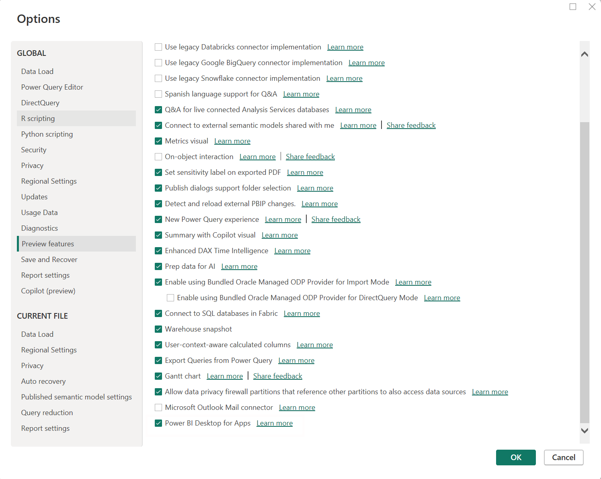

Then install Power BI Desktop for Apps.

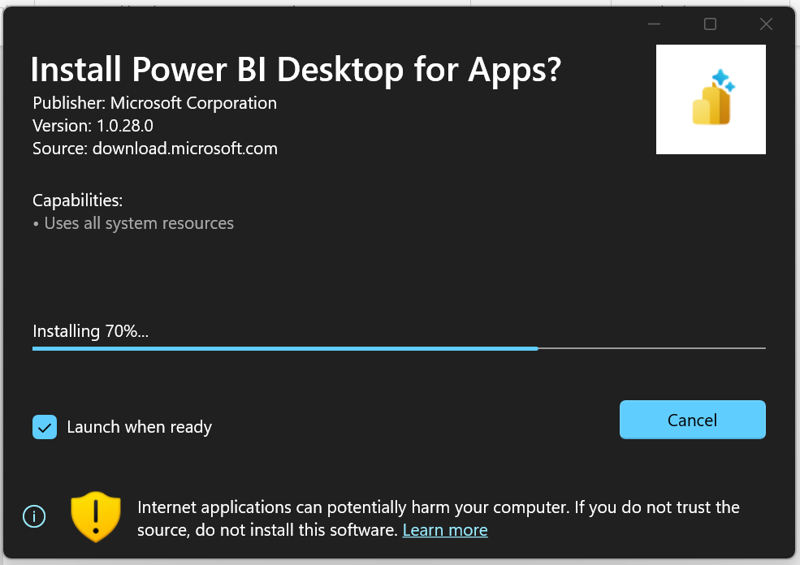

Then log in to Fabric and GitHub Copilot.

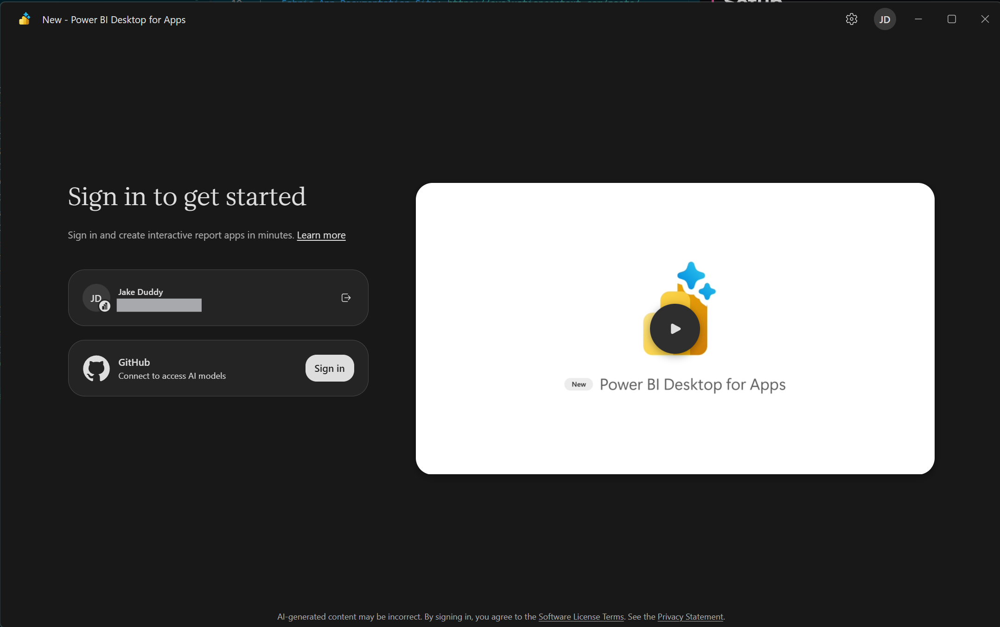

The interface is a simple AI chat interface.

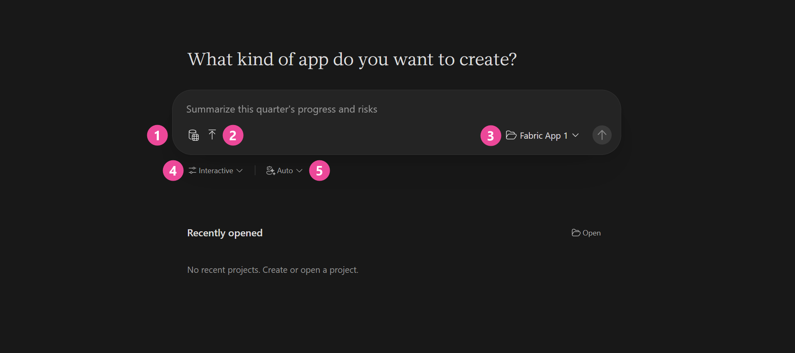

- :material-numeric-1-circle: Select a semantic model (in Fabric)
- :material-numeric-2-circle: Upload images and files
- :material-numeric-3-circle: Save location
- :material-numeric-4-circle: Mode and tool permissions
- :material-numeric-5-circle: Model

The semantic model needs to already be developed and published, as Power BI Desktop for Apps doesn't create or modify semantic models.

Interactive is the only mode, but you can specify whether it asks before running tools or allows all.

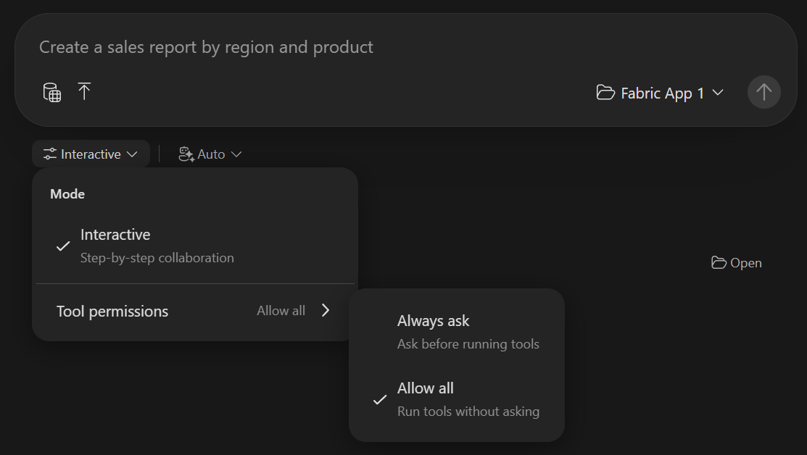

Model selection is auto or manual, where you can pick from many models (Claude, GPT and others), and set the effort level and context window size.

=== "Auto"

    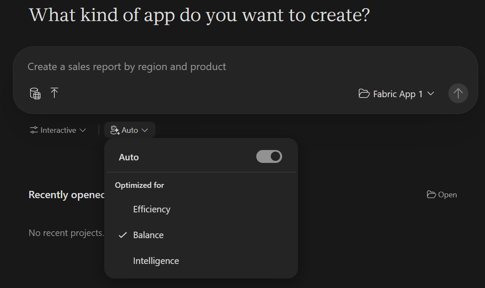

=== "Manual"

    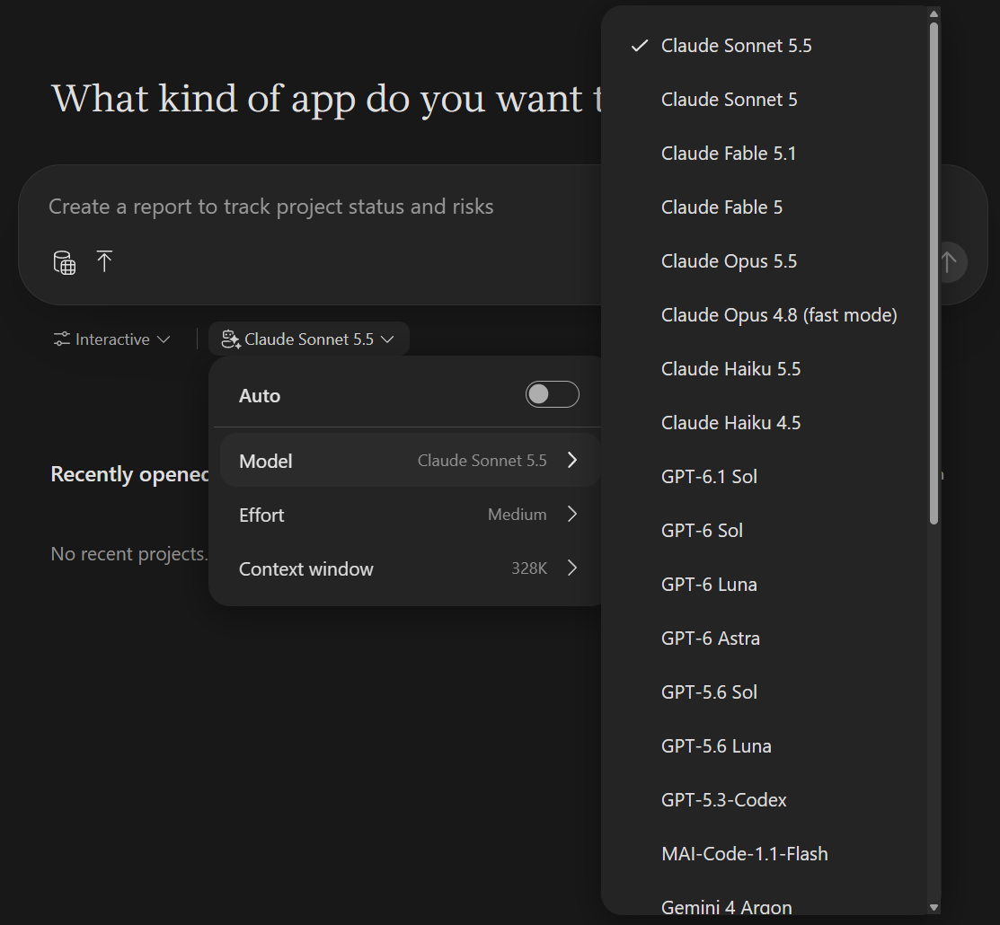

All of these models are served through GitHub Copilot, which is the only provider you can use in the app.

## Building the App

I connected to a demo semantic model, and prompted for an exec dashboard.

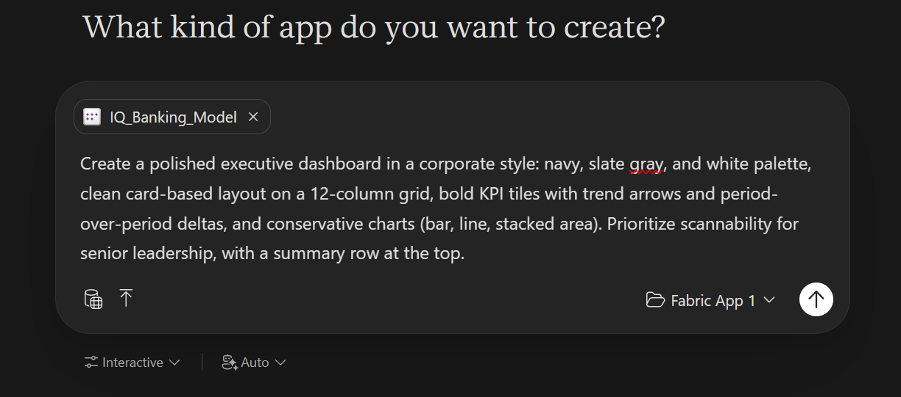

I had to allow the Node.js JavaScript runtime.

The hello world screen mentions "This is a blank data app template, with built-in skills and capabilities for visual analytics and data decision-making", and links to the [data app template docs](https://learn.microsoft.com/en-us/fabric/apps/data-apps-template), which we will see [later](#project-files).

!!! quote "MS Docs: Data app template"

    Use the data app template with a Fabric semantic model connector to build an analytical Fabric app. The template provides visualization, formatting, data grid, and browser-validation patterns. The connector provides typed, delegated access to a semantic model through the Fabric Apps client.
    -- <cite>[MS Docs: Data app template](https://learn.microsoft.com/en-us/fabric/apps/data-apps-template)</cite>

While building it loads the built-in skills, and registers a connector for the semantic model.

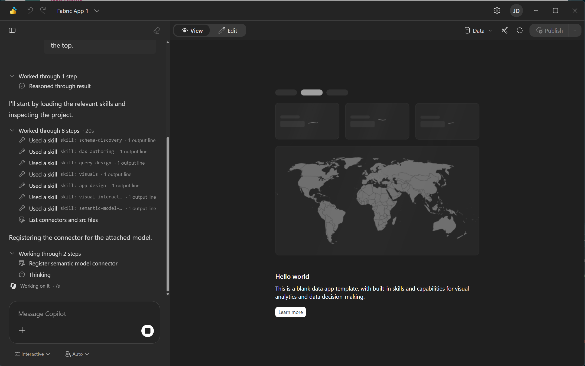

It failed for me at this point.

!!! prompt "First Attempt"

    > I couldn't build the dashboard because the Rayfin CLI can't see the IQ_Banking_Model semantic model.
    >
    > **What failed:** `npx rayfin connector add` returned "Item not found" for workspace 2b362b35-… and item f60dd8e2-…. A search for "IQ_Banking_Model" across all workspaces found nothing.
    >
    > **Current sign-in:** The CLI is signed in as [account redacted]. It lists 21 other models, none of them IQ_Banking_Model. The cause is unconfirmed. This may be a different account or tenant from the one that owns the model, or the account may lack access to that workspace.
    >
    > **To continue**, either run `npx rayfin login` with the account that can open IQ_Banking_Model, or send me the workspace and item IDs from its Fabric URL. I haven't changed any files.
    >
    > Once the model is reachable, I'll build the navy, slate and white dashboard with KPI tiles, trend deltas, and bar, line and stacked-area charts.

Although I was logged in to the app with the correct account, Rayfin was logged in to another account. I had to go to the terminal and log in with the correct account.

```bash
npx rayfin login
```

The app brings its own toolchain, but the Rayfin sign-in appears to be shared with my existing install. If I had never used Rayfin, from another account, this would not have been an issue.

I then went back to the app.

!!! prompt "Second Attempt"

    ```plaintext
    continue
    ```

The result is a responsive app, where the visuals size to the screen, with a light and dark mode.

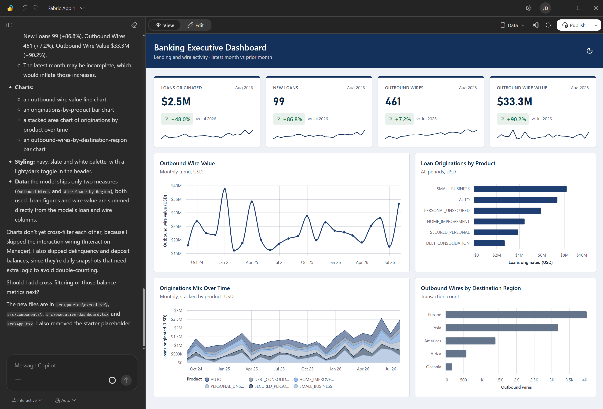

!!! quote "Power BI Blog: Power BI at Ignite"

    They also behave the way Power BI users expect. With the Fabric visuals packages you get familiar Power BI capabilities like tooltips, cross-filtering and cross-highlighting, so selecting a point in one visual focuses the rest of the page. They support keyboard navigation and screen readers too.
    -- <cite>[Power BI Blog: Power BI at Ignite](https://community.fabric.microsoft.com/blog/fbc_pbiupdatesblog/power-bi-at-ignite-building-on-the-momentum/5422974)</cite>

The app has tooltips, but no cross filtering, so it didn't use all of the [template capabilities](https://learn.microsoft.com/en-us/fabric/apps/data-apps-template). The `AGENTS.md` and the `visual-interactivity` skill in the project both tell the agent that components on a page interact by default, but the generated dashboard doesn't wire them up. The agent did say at the end of its reply that it had skipped the interaction wiring, and offered to add it. I was doing a quick test so I didn't notice. You need to manually verify the app before publishing.

The token cost was very low for the one pager.

### Edit Mode

The app is presented in view mode, but you can toggle to edit, to change some basic theme colours or fonts. Most editing will be via chat.

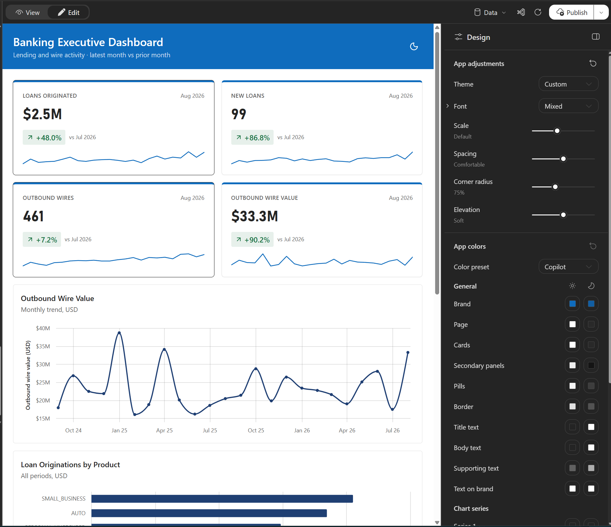

### Pinned Context

In edit mode you are able to select one or more elements as context for the chat.

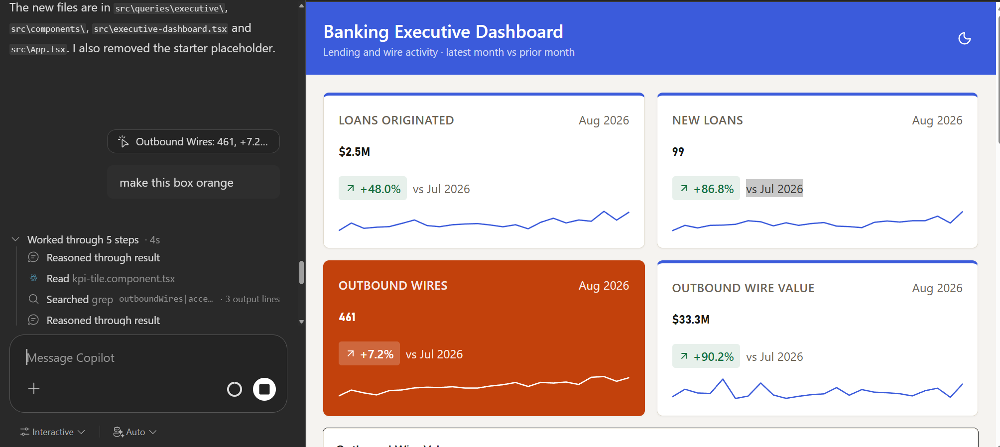

### Project Files

If we select the VS Code button we can see it added all the files to the folder selected at the start.

It even initialised git, with a `Fabric Data Apps baseline` commit. Every agent change is a commit (`Fabric Data Apps agent turn`) and every change in edit mode is a commit (`Fabric Data Apps manual edit`).

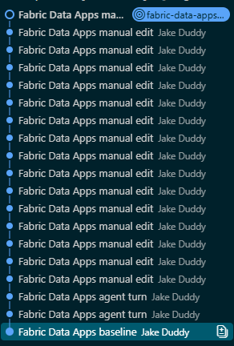

There are no options for skills in the app, but there are skills built in. The project has an `AGENTS.md`, a `.mcp.json` that registers the Rayfin MCP server, and 14 skills under `.agents/skills`.

| Skill | Covers |
|---|---|
| `schema-discovery` | Grounding DAX work in the semantic model catalog, measures and relationships |
| `dax-authoring` | Writing and testing DAX queries against the semantic model |
| `query-design` | What to do in DAX, TypeScript or Vega-Lite |
| `analytics` | Reading semantic model data through Rayfin connectors |
| `semantic-model-data` | How the app reads semantic model data at runtime |
| `visuals` | Charts, KPI cards, data grids and slicers |
| `visual-interactivity` | Selections, cross-filtering and cross-highlighting |
| `app-design` | App layout, UI components and visual design decisions |
| `rayfin` | Any Rayfin task: scaffolding, data models, auth, storage, deployment |
| `rayfin-connectors` | Connecting existing Fabric data sources to Rayfin apps |
| `rayfin-functions` | Rayfin user-defined functions |
| `rayfin-storage` | Rayfin file and blob storage |
| `rayfin-auth-claims` | Rayfin dynamic auth claims |
| `rayfin-schema-drift` | Recovering from a blocked schema-drift apply |

The visuals are Vega-Lite. Each one has a DAX query and a Vega-Lite spec under `src/queries`.

=== "DAX"

    ```dax title="wires-by-region.dax"
    EVALUATE
    SUMMARIZECOLUMNS(
      dim_geography[region],
      "Outbound Wires", [Outbound Wires],
      "Wire Share by Region", [Wire Share by Region]
    )
    ORDER BY [Outbound Wires] DESC
    ```

=== "Vega-Lite"

    ```json title="wires-by-region.json"
    {
      "$schema": "https://vega.github.io/schema/vega-lite/v5.json",
      "mark": { "type": "bar", "cornerRadiusEnd": 2 },
      "encoding": {
        "y": { "field": "region", "type": "nominal", "sort": "-x", "title": null },
        "x": {
          "field": "outboundWires",
          "type": "quantitative",
          "title": "Outbound wires",
          "axis": { "format": ",.0f" }
        },
        "color": { "value": "#64748b" },
        "tooltip": [
          { "field": "region", "type": "nominal", "title": "Region" },
          { "field": "outboundWires", "type": "quantitative", "title": "Outbound wires", "format": ",.0f" },
          { "field": "wireShare", "type": "quantitative", "title": "Share", "format": ".1%" }
        ]
      }
    }
    ```

The smaller scope shows in `rayfin/rayfin.yml`. Data, storage and functions are all disabled, leaving auth, static hosting and one semantic model connector.

```yaml title="rayfin.yml" hl_lines="10-13 20-21"
id: fabric-app-1
name: Fabric App 1
version: 1.0.0
services:
  auth:
    enabled: true
    fabric:
      enabled: true
    # allowedRedirectUris omitted
  data:
    enabled: false
  storage:
    enabled: false
  staticHosting:
    enabled: true
    assetAccess: protected
    folder: dist
    buildCommand: npm run build:fabric
    indexDocument: index.html
  functions:
    enabled: false
connectors:
  - name: iq_banking
    type: fabric-semanticmodel
    config:
      workspaceId: <workspaceId>
      itemId: <itemId>
    auth:
      type: delegated
    version: "1"
    operations:
      - name: executeQuery
```

## Publishing

Publishing was like publishing with Power BI, select Publish and pick a workspace. It published the app, plus a child user data function.

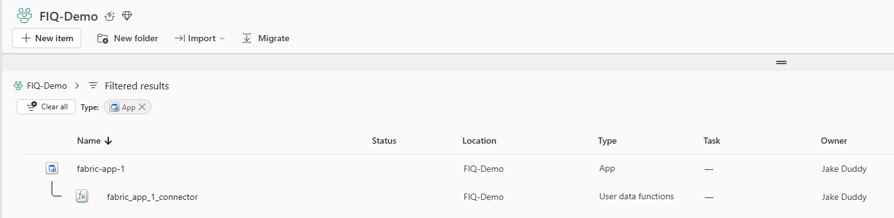

On publish it squashed the commits down to three: `Fabric Data Apps baseline`, `Fabric Data Apps session` and `Fabric Data Apps publish`.

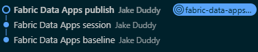

The app has a live URL. I went to it in incognito mode, so not logged in, and was prompted to log in to view the app.

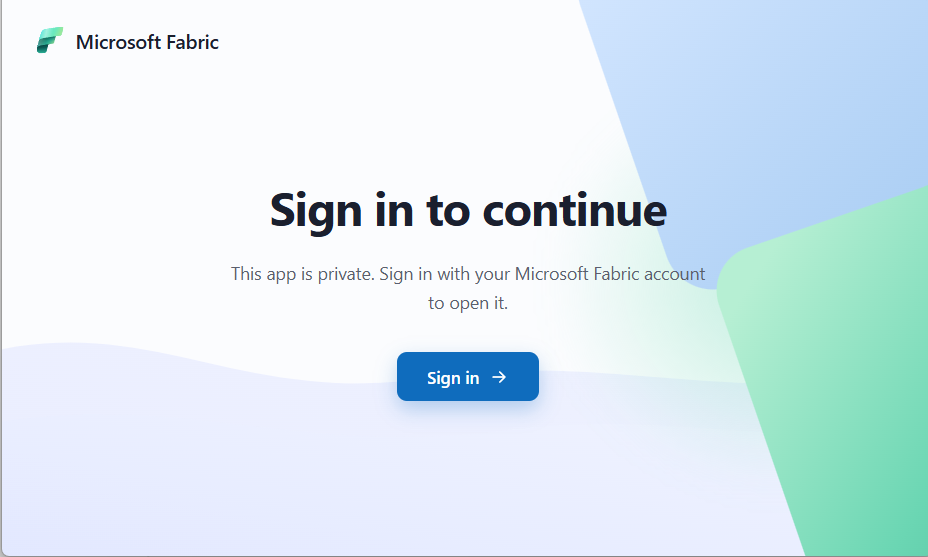

The app requires sign-in. In `rayfin.yml` the static hosting is set to `assetAccess: protected` and Fabric auth is enabled. The semantic model connector uses `auth: type: delegated`, so queries run as the signed-in user. Access to the app and access to the semantic model are separate, sharing the app doesn't grant access to the model.

!!! quote "MS Docs: Publish a Fabric app and manage access (preview)"

    Recipients also need **Read permission** on each semantic model the app uses. App authors also need **Build permission**.
    -- <cite>[MS Docs: Publish a Fabric app and manage access (preview)](https://learn.microsoft.com/en-us/power-bi/create-reports/desktop-for-apps/publish-app)</cite>

### User Data Function

You can't view the internals of the user data function in the Fabric UI, so I used the [Fabric CLI](https://microsoft.github.io/fabric-cli/) to export the definition. You could also use git integration.

```bash
fab export "FIQ-Demo.Workspace/fabric_app_1_connector.UserDataFunction" -o ./udf-export
```

The function is a generic Rayfin connector, not code written for my app. It defines 15 functions, but my app only needs one, `rayfin_semantic_model_v1`. I assume the others would come into play if you used full fat Rayfin.

This is how the app sends the DAX queries it generated to the semantic model, and returns the results. It calls the public `executeDaxQueries` endpoint, or an internal `executeDaxQueriesInternal` endpoint, which a comment in the code says "lets Read-only (View) users execute DAX".

??? example "rayfin_semantic_model_v1"

    ```python
    @udf.streaming_function()
    async def rayfin_semantic_model_v1(payload: dict, accesstoken: str) -> fn.StreamResponse:
        input_data = payload.get("input", {})

        dataset_id = input_data.get("itemId")
        workspace_id = input_data.get("workspaceId")
        dax_query = input_data.get("query")
        baas_item_id = input_data.get("baasItemId")

        if not workspace_id or not dataset_id or not dax_query:
            raise ValueError("workspaceId, datasetId and query are required")

        # Route based on the presence of a BaaS artifact object id. When provided,
        # target the internal (relaxed-Build) endpoint at the host root and pass the
        # id in the X-Rayfin-ArtifactObjectId header. Otherwise use the public
        # executeDaxQueries endpoint (byte-identical to prior behavior).
        headers = {
            "Authorization": f"Bearer {accesstoken}",
            "Content-Type": "application/json",
        }
        if baas_item_id:
            origin = "{0.scheme}://{0.netloc}".format(urlparse(_POWERBI_BASE))
            url = f"{origin}/{_INTERNAL_ROUTE_PREFIX}/models/{dataset_id}/executeDaxQueriesInternal"
            headers[_RAYFIN_ARTIFACT_OBJECT_ID_HEADER] = baas_item_id
        else:
            url = f"{_POWERBI_BASE}/datasets/{dataset_id}/executeDaxQueries"
        body = {"query": dax_query}

        session = await _get_session()

        # `await session.post(...)` returns once the response *headers* are received
        # (aiohttp reads the body lazily via `resp.content`), so we learn the real
        # upstream status before deciding how to respond — without buffering the body.
        resp = await session.post(url, json=body, headers=headers)

        if resp.status != 200:
            # Surface the upstream error verbatim and don't open a stream.
            detail = await resp.text()   # fully drains the body -> connection returns to pool
            await resp.release()         # release the RESPONSE, never the shared session
            return fn.StreamResponse(
                iter([detail.encode("utf-8")]),
                media_type=resp.headers.get("Content-Type", "application/json"),
                status_code=resp.status,
            )

        async def relay():
            try:
                # iter_any() yields each TCP read as soon as it lands -> lowest latency.
                async for chunk in resp.content.iter_any():
                    yield chunk
            finally:
                # Release the response so its connection returns to the pool (or is
                # closed if the client disconnected mid-stream). Do NOT close the
                # shared session here.
                await resp.release()

        return fn.StreamResponse(relay(), media_type=_ARROW_MEDIA_TYPE)
    ```

## Limitations

!!! quote "MS Docs: What is Power BI Desktop for Apps (preview)?"

    - You must be signed in to Power BI to use Power BI Desktop for Apps.
    - You need a GitHub Copilot license to use Power BI Desktop for Apps.
    - Power BI Desktop for Apps doesn't create or modify semantic models. Use an existing semantic model hosted in the Power BI service. Connections to local semantic models aren't supported.
    - Publishing to Pro workspaces is coming soon. For now, choose a workspace on Fabric capacity.
    - OneDrive locations aren't currently supported for app projects. Save projects in a local folder outside OneDrive.
    - Local app preview supports data access through Power BI semantic models in the service. Other data sources aren't supported in local app preview.
    - Write-back isn't supported in local app preview.
    - Published apps can't be renamed from Power BI Desktop for Apps. Rename them in the Fabric portal. To rename a local project folder, first close Power BI Desktop for Apps. See Rename or move a local project.
    - If Power BI Desktop for Apps is already running, launching it from Power BI Desktop doesn't automatically attach the report's semantic model. To attach it, select **Get data** on the start page. In an open project, select the plus (+) button in the chat bar, then select **Get data**.

    -- <cite>[MS Docs: What is Power BI Desktop for Apps (preview)?](https://learn.microsoft.com/en-us/power-bi/create-reports/desktop-for-apps/overview)</cite>

## Conclusion

**Is it a good tool?** Yes. The experience was generally good, and quicker than agentic development of a Power BI report. It will help many people, with a simple experience and sensible, safe defaults.

**Would I use it?** Most likely not. I would prefer to take the skills and work in an IDE with the Rayfin SDK, so I can see what files are changing, commit for myself, and use more of Rayfin's functionality. That is also the only way to use a provider other than GitHub Copilot.

Report developers still need to know about report design, and how to make a report answer the questions people want answered.

Whether it will replace Power BI reports is yet to be seen. It depends on whether the agentic experiences in Power BI improve, but reports are going nowhere soon. There are millions of reports that already exist, and it may not make sense to transition many of them.
