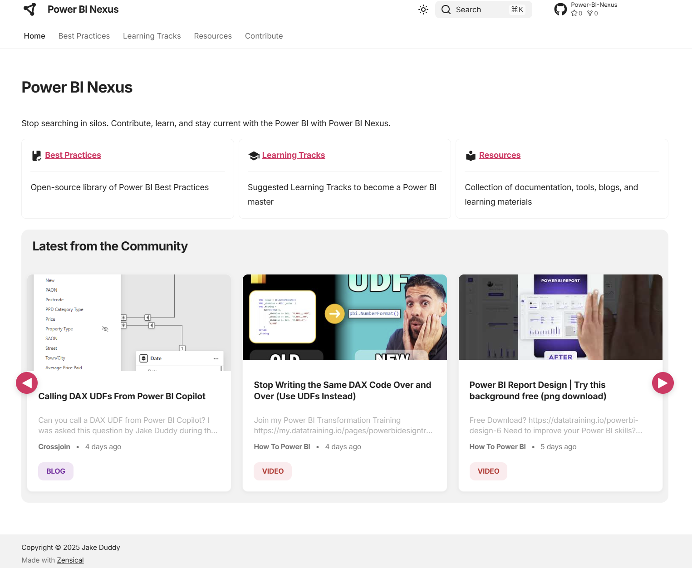
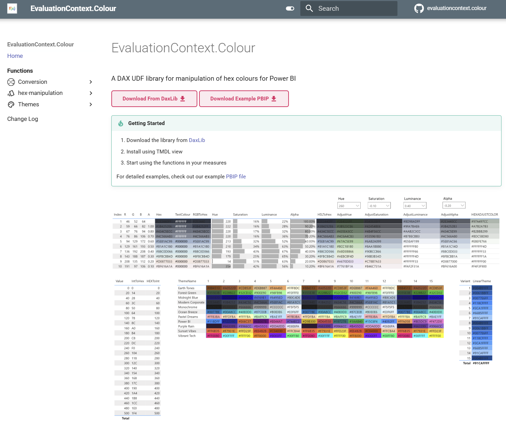
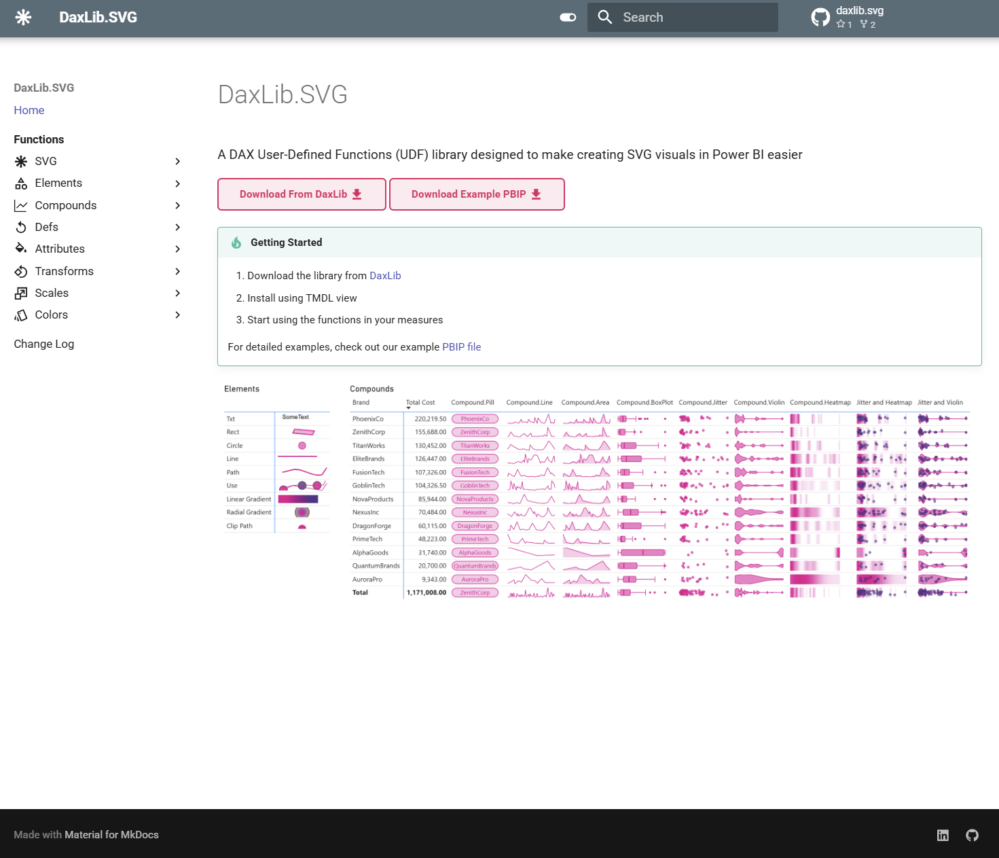

---
hide:
  - navigation
  - toc
head:
  word: projects
  pos: noun
  gloss: things built to scratch an itch, then open-sourced
  title: Open-source tools for the <em>Fabric</em> community.
  lede: Two DAX Lib libraries and a community knowledge hub.
---

<article class="ec-gcard ec-project" markdown>

 <i>· Community site</i>
{ .ec-gn }

### Power BI Nexus { .ec-project__title }

Stop searching in silos. Contribute, learn, and stay current with Power BI — a community-curated knowledge hub that brings together the best resources in one place.
{ .ec-project__desc }

[:material-web: site](https://evaluationcontext.com/Power-BI-Nexus/){ .ec-tile .ec-tile--hot }
[:fontawesome-brands-github: github](https://github.com/EvaluationContext/Power-BI-Nexus){ .ec-tile }

[{ .off-glb loading=lazy }](https://evaluationcontext.com/Power-BI-Nexus/){ target=_blank rel=noopener }

</article>

<article class="ec-gcard ec-project" markdown>

 <i>· DAX Lib · UDF library</i>
{ .ec-gn }

### EvaluationContext.<wbr>Colour { .ec-project__title }

A [DAX Lib](https://daxlib.org/) UDF library for manipulation of hex colours in Power BI. Blend, lighten, darken, and transform colours directly in your DAX measures.
{ .ec-project__desc }

[:material-book-open-variant: docs](https://evaluationcontext.com/evaluationcontext.colour/){ .ec-tile .ec-tile--hot }
[:daxlib-logo: daxlib](https://daxlib.org/package/EvaluationContext.Colour/){ .ec-tile }

[{ .off-glb loading=lazy }](https://evaluationcontext.com/evaluationcontext.colour/){ target=_blank rel=noopener }

</article>

<article class="ec-gcard ec-project" markdown>

 <i>· DAX Lib · UDF library</i>
{ .ec-gn }

### DaxLib.SVG { .ec-project__title }

A [DAX Lib](https://daxlib.org/) library designed to make creating SVG visuals in Power BI easier. Build sparklines, heatmaps, and custom visualizations with pure DAX.
{ .ec-project__desc }

[:material-book-open-variant: docs](https://evaluationcontext.com/daxlib.svg/){ .ec-tile .ec-tile--hot }
[:daxlib-logo: daxlib](https://daxlib.org/package/daxlib.svg/){ .ec-tile }

[{ .off-glb loading=lazy }](https://evaluationcontext.com/daxlib.svg/){ target=_blank rel=noopener }

</article>

